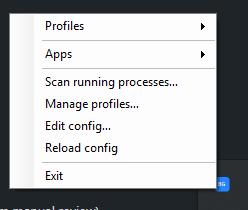

# BgToggle

A minimal Windows tray app that toggles groups of background programs on and off via named profiles. Designed for the case where you have 30–40 tray-resident apps (Spotify, Discord, Razer Synapse, OneDrive, AMD Adrenalin, NVIDIA stuff, etc.) and want a "Working" / "Gaming" / "Optimized" / "All off" switcher.



## Install

Download `BgToggle-Setup-<version>.exe` from the [latest release](https://github.com/emanuellonnberg/bgtoggle-windows/releases/latest) and run it. It asks for administrator rights once, installs to `C:\Program Files\BgToggle`, and sets up the [helper service](#helper-service). .NET is bundled, so there is nothing else to install.

The installer isn't code-signed yet, so Windows SmartScreen shows "Windows protected your PC" / "Unknown publisher". Choose **More info → Run anyway**.

BgToggle checks GitHub about once a day and shows **Update available** in the tray menu when a newer release exists. It never downloads anything by itself. Set `"checkForUpdates": false` in the config to turn the check off.

## What it does

- Loads a JSON config from `%APPDATA%\BgToggle\config.json` describing apps and profiles.
- Tray icon menu with two submenus:
  - **Profiles** — click a profile to apply it. The applier diffs current state against the target and only stops/starts what needs changing.
  - **Apps** — per-app toggle (checkmark reflects whether the process is currently running).
- For each app you can configure:
  - `killMethod`: `graceful` (WM_CLOSE → wait → force) or `force` (kill tree immediately).
  - `gracefulTimeoutMs`: how long to wait for graceful exit.
  - `autostart`: `registryRunUser`, `startupFolder`, or `none`. When set, disabling the app also disables its autostart so it doesn't come back next boot. Enabling restores the original value from a stash key under `HKCU\Software\BgToggle\Stash`. (`registryRun`, the machine-wide HKLM key, is no longer managed: BgToggle never runs as administrator, and no bundled recipe needs it.)

## Recipe-driven shutdowns

Every "background app" sits in roughly one of five buckets — graceful-cooperator, tray-trap, service-watchdog, multi-process, service-only-with-side-effects — and the right way to stop it depends on the bucket. That knowledge lives in a bundled `recipes.json` next to the binary, not in code.

`ShutdownStrategy` values:

- `graceful` — WM_CLOSE → wait → kill tree. For apps that honor close (Dropbox, Greenshot, f.lux).
- `killTree` — kill immediately, including children. For tray-trap apps that hide on WM_CLOSE (Discord, Slack, Teams) and for multi-process apps where the parent doesn't take its helpers down.
- `command` — invoke a CLI on the launch exe for a clean shutdown. OneDrive (`/shutdown`) and Steam (`-shutdown`) need this; force-killing them can leave files / download manifests inconsistent.
- `stopServiceOnly` — no UI process to kill, just stop services.
- `stopServiceThenKill` — service is the watchdog; stop it first, then kill the UI tree. For Razer Synapse, Logitech G HUB, Adobe Creative Cloud, Corsair iCUE, Armoury Crate, MSI Center, AnyDesk, TeamViewer, NordVPN, ProtonVPN.

A recipe also carries `servicesToLeaveAlone` — driver-tied services we should never touch (e.g. NVIDIA's `NvContainerLocalSystem`, AMD's `AMD External Events Utility`).

A user's `AppDefinition` becomes a thin reference: `{ "id": "spotify", "displayName": "Spotify", "recipeId": "spotify" }`. The recipe carries the global knowledge; the app definition carries personal config (install path override, which profiles to include in). When recipes update upstream, your config keeps working.

## Helper service

The tray app always runs as you, never as administrator, so every app it starts runs as you too. A few things need admin rights: stopping vendor services such as Razer Synapse, iCUE, G HUB or Adobe Creative Cloud, and ending the elevated processes those vendors run. For those, the installer adds a small Windows service, **BgToggle Helper** (`BgToggleHelper`).

- It only acts on apps listed in the `recipes.json` installed next to it in `Program Files`. Your config and `recipes.local.json` can't widen that list.
- The tray only asks it about recipe ids. It never sends paths, commands, or service or process names.
- If a local recipe overrides a bundled one with the same id, the helper isn't used for that app.
- It only ends processes in your own session, plus the recipe's own service processes.
- Check it with `sc query BgToggleHelper`, and see its log in `%ProgramData%\BgToggle\logs`. The tray's **System** menu shows *Helper: running / not installed*.

Without the helper (for example `dotnet run` from a clone), everything still works except stopping and starting services, which then fail and are logged. Those apps fall back to being killed.

## Project layout

```
BgToggle/
├── BgToggle.csproj              Tray app: .NET 10 + WinForms
├── Program.cs                   Entry point; installer flags (--first-run, --uninstall-cleanup)
├── TrayApp.cs                   NotifyIcon + ContextMenuStrip
├── Models.cs                    AppDefinition / Profile / Config + AppResolver
├── ResolvedApp.cs               Runtime plan for one app (recipe + overrides)
├── ConfigStore.cs               JSON load/save for user config
├── RecipeStore.cs               Bundled + local recipes; which ids are bundled
├── ProcessManager.cs            Find / launch / stop; uses the helper when it may
├── AutostartManager.cs          Registry Run + Startup folder, with stash/restore
├── TrayAutostart.cs             BgToggle's own "start at logon"
├── UpdateCheck.cs               "Newer release on GitHub?" check
├── ProfileApplier.cs            Diff + apply over ResolvedApp
├── recipes.json                 Bundled recipe library (50+ apps)
├── src/BgToggle.Core/           Shared: recipes, logger, services, helper protocol + pipe
├── src/BgToggle.Helper/         The BgToggle Helper Windows service
├── installer/BgToggle.iss       Inno Setup script
└── tests/BgToggle.Tests/        xUnit tests
```

## Build & run

```
dotnet build
dotnet run
```

To build the installer locally (needs [Inno Setup 6](https://jrsoftware.org/isinfo.php)):

```
dotnet publish BgToggle.csproj -c Release -r win-x64 --self-contained -o publish
dotnet publish src/BgToggle.Helper/BgToggle.Helper.csproj -c Release -r win-x64 --self-contained -o publish
iscc /DAppVersion=0.0.1 installer\BgToggle.iss
```

Pushing a tag like `v0.2.0` makes CI build the installer and publish a GitHub release.

First run creates an empty config at `%APPDATA%\BgToggle\config.json` and loads recipes from `recipes.json` next to the exe. Use **Scan running processes…** to detect known apps and add them to the config; then **Manage profiles…** to define which apps each profile keeps running.

## Contributing recipes

Recipes are the most valuable thing this project can grow. If your favorite tray app isn't covered or has the wrong shutdown strategy on your machine, see [CONTRIBUTING.md](CONTRIBUTING.md) and [docs/RECIPES.md](docs/RECIPES.md). The [issue templates](.github/ISSUE_TEMPLATE/) collect the right info up front.

## What's still stubbed

1. **Scheduled-task autostart.** Not all autostart entries live in Run keys; many tray apps use scheduled tasks. `Microsoft.Win32.TaskScheduler` (NuGet) handles them.
2. **Recipe distribution.** `recipes.json` ships with each release. Long term it could update separately, like uBlock filter lists or winget manifests.
3. **Better matching.** `ExeName` matching catches all instances by process name. If two managed apps share an exe name (rare but possible), you'd need to disambiguate by full path.

## Design notes

- **Profile = set of app IDs that should be running.** Nothing more. The diff is computed from current OS state, not from the previously active profile, so it's robust against the user manually starting/stopping things between profile applies.
- **We only touch apps that are explicitly in the config.** A profile switch never kills a random `chrome.exe` the user opened. This is by design — the tool is opt-in per app.
- **Autostart is symmetric.** Disabling an app stashes its autostart value; enabling restores it from the stash. The stash lives in `HKCU\Software\BgToggle\Stash`. Uninstalling puts stashed entries back for the account that runs the uninstaller. On a standard (non-admin) account, use **System → Restore all autostart entries** before uninstalling. The uninstaller runs as the admin whose password you type, so it can't reach your entries.
